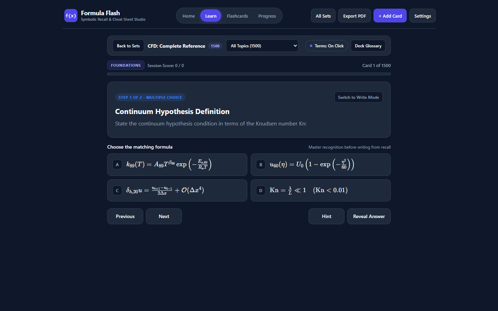
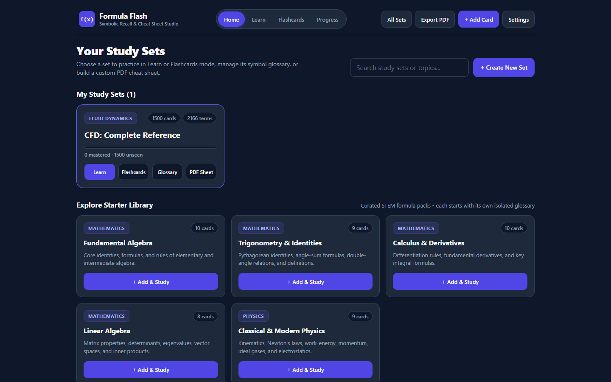

  

# FormulaFlash

**Math and science flashcards that check real algebraic equivalence, rearranged equations, and units offline.**

FormulaFlash lets STEM students create flashcards with formatted equations, study through adaptive Flashcard and Learn modes, and have typed formula answers graded mathematically on your own device without accounts or internet access.

---

## Download

| Platform | Download | How to Install |
| :--- | :--- | :--- |
| **Windows** | [FormulaFlash-Windows.exe](https://github.com/DontKwo/formulaflash/releases/latest/download/FormulaFlash-Windows.exe) | [Windows Install Steps](docs/INSTALLATION.md#windows) |
| **macOS** | [FormulaFlash-macOS.zip](https://github.com/DontKwo/formulaflash/releases/latest/download/FormulaFlash-macOS.zip) | [macOS Install Steps](docs/INSTALLATION.md#macos) |
| **Linux** | [FormulaFlash-Linux.tar.gz](https://github.com/DontKwo/formulaflash/releases/latest/download/FormulaFlash-Linux.tar.gz) | [Linux Install Steps](docs/INSTALLATION.md#linux) |
| **Android** | [FormulaFlash-Android.apk](https://github.com/DontKwo/formulaflash/releases/latest/download/FormulaFlash-Android.apk) | [Android APK Guide](docs/APK_INSTALLATION.md) |

Browse release notes on [All Releases](https://github.com/DontKwo/formulaflash/releases/latest).

---

## Screenshots

  

  

---

## How to Use

1. **Download FormulaFlash** from the table above for your computer or Android phone.
2. **Open the app** following [Desktop Installation Guide](docs/INSTALLATION.md) or [Android APK Installation Guide](docs/APK_INSTALLATION.md) if prompted by your device.
3. **Select a starter formula deck** or tap **Add Card** to build your own equation, numeric, or text cards.
4. **Practice in Learn or Cards mode** using the built-in math keyboard, and export backups or PDF cheat sheets anytime.

---

## Key Features

- **Equivalence-Aware Formula Grading**: Accepts algebraically equivalent forms (`y + x`, `P = nRT / V`) while catching distinct symbols like `\hat{\rho}` vs `\rho`.
- **Visual Math Editor**: Type fractions, exponents, subscripts, Greek letters, and roots with a built-in keyboard.
- **Adaptive Learn Mode**: Steps from recognition prompts into typed recall with retype-after-miss practice and spaced repetition.
- **Offline Storage & PDF Cheat Sheets**: Stores decks locally in your device database and exports printable formula sheets and `.flashset` backups.
- **Open Source**: Transparent source code released under the [MIT License](LICENSE).

---

## Safety & Disclaimers

- **Official `main` Releases Only**: Only download executables or APKs from [DontKwo/formulaflash](https://github.com/DontKwo/formulaflash/releases/latest) (`main` branch). Never download forked releases unless you are certain they contain no malware; only the `main` stream is maintained by the author, and I make no promises.
- **OS & Phone Security Warnings**: Windows SmartScreen, macOS Gatekeeper, and Android Play Protect will likely warn that independently distributed apps are unrecognized or unsafe. Bypassing those prompts is strictly at your own discretion. Follow [Desktop Installation Guide](docs/INSTALLATION.md) or [Android APK Installation Guide](docs/APK_INSTALLATION.md) for instructions.
- **AS-IS Disclaimer**: Provided "AS IS" under the [MIT License](LICENSE) with zero warranty or liability. Use at your own risk, verify critical exam formulas independently, and back up your `.flashset` decks regularly.

---

## Documentation

### User Documentation
- [User Guide](docs/USER_GUIDE.md)
- [Desktop Installation Guide](docs/INSTALLATION.md)
- [Android APK Installation Guide](docs/APK_INSTALLATION.md)
- [Frequently Asked Questions](docs/FAQ.md)
- [Known Issues](docs/known-issues.md)

### Developer Documentation
- [Developer Guide](docs/DEVELOPMENT.md)
- [Developer uv Installation](docs/UV_INSTALLATION.md)
- [Human Setup](docs/HUMAN_SETUP.md)

### AI, Mathematical Proof & Technical Documentation
- [AI Agent Rules](AGENTS.md)
- [System Architecture](docs/ARCHITECTURE.md)
- [Expression Language Specification](docs/EXPRESSION_LANGUAGE.md)
- [Testing Guide](docs/testing.md)
- [Test Matrix Report](docs/test-matrix.md)
- [PDF Export ADR](docs/adr/0002-pdf-export-jspdf.md)

### Legal & Security Policies
- [Security Policy](SECURITY.md)
- [Third-Party Notices](THIRD_PARTY_NOTICES.md)
- [MIT License](LICENSE)
